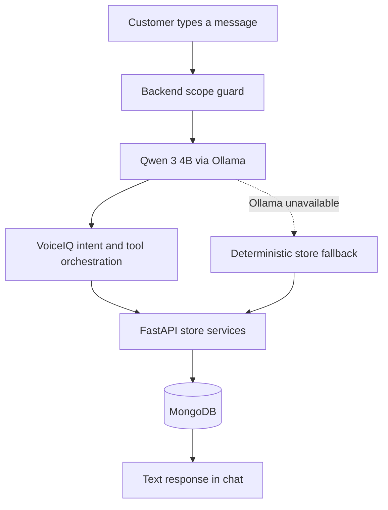
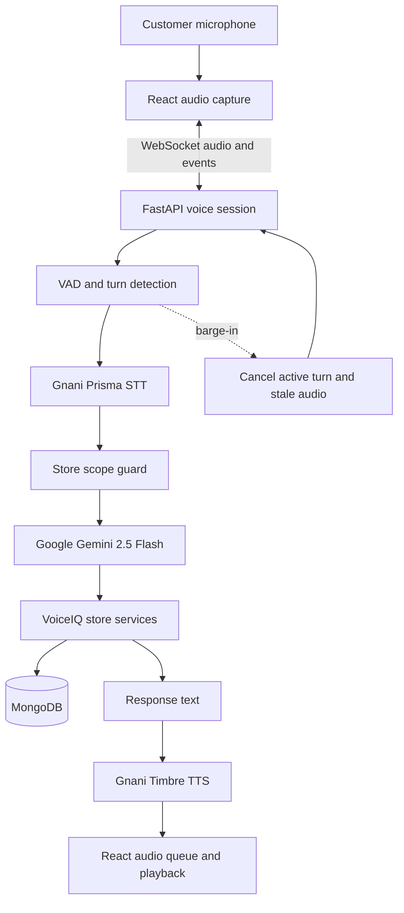

# VoiceIQ India 🇮🇳

### A multilingual, voice-powered e-commerce and customer-support platform for India

VoiceIQ India is an AI-powered shopping experience that lets customers discover products, manage their carts, follow orders, and contact store support using either text or natural spoken conversations. It combines a React storefront, a FastAPI backend, MongoDB, two purpose-specific AI routes, and Gnani AI speech services.

> **Project focus:** Make online shopping more conversational and accessible through Indian-language text and voice interactions.

---

## ✨ Highlights

- **E-commerce storefront:** Browse categories, search products, view product details, compare options, and check prices and availability.
- **Dual-AI architecture:** Qwen 3 4B through Ollama handles normal text conversations; Google Gemini 2.5 Flash handles real-time spoken conversations.
- **Multilingual voice support:** Gnani Prisma Speech-to-Text (STT) and Gnani Timbre Text-to-Speech (TTS) support the voice experience.
- **Hands-free voice assistant:** Continuous microphone capture, voice activity detection, conversation turns, and interruption (barge-in) handling.
- **Shared conversation history:** Text and voice interactions use a shared conversation ID and persist ordered messages in MongoDB.
- **Grounded store actions:** Product, cart, order, cancellation, and return operations are handled by backend services rather than allowing an LLM to modify the database directly.
- **Safer consequential actions:** Cancellation and return requests use an explicit confirmation flow.
- **Customer accounts:** Registration, login, authenticated sessions, and account-aware store operations.
- **Admin and voice analytics:** Store metrics, intent distribution, language statistics, and voice interaction insights.

---

## 🧠 Dual-AI architecture

VoiceIQ selects the AI provider based on the interaction mode. The two routes are deliberately separate.

### Route 1 — Normal text conversations



- **Provider:** Qwen 3 4B
- **Runtime:** Ollama
- **Local endpoint:** `http://127.0.0.1:11434`
- **Chat API:** `/api/chat`
- **Streaming:** Ollama newline-delimited JSON (NDJSON)
- **Fallback:** Deterministic store orchestrator. Text conversations do not silently switch to Gemini or Hugging Face.

### Route 2 — Real-time spoken conversations



- **Conversational AI:** Google Gemini 2.5 Flash through the Google Gen AI SDK.
- **Speech-to-Text:** Gnani Prisma (`https://api.vachana.ai/stt/v3`).
- **Text-to-Speech:** Gnani Timbre (`https://api.vachana.ai/api/v1/tts/inference`).
- **Transport:** FastAPI WebSocket voice sessions.
- **Voice controls:** VAD, turn IDs, interruption handling, sentence-based TTS delivery, and audio playback management.
- **Fallback:** The deterministic store orchestrator can handle supported store operations if Gemini is unavailable; Timbre can speak the fallback response when configured and available.

### Provider routing at a glance

| Interaction | AI provider | Speech services |
|---|---|---|
| Normal text chat | Qwen 3 4B via Ollama | Not required |
| Live spoken conversation | Gemini 2.5 Flash | Prisma STT + Timbre TTS |
| Text fallback when Ollama is unavailable | Deterministic store orchestrator | Not required |
| Voice fallback when Gemini is unavailable | Deterministic store orchestrator | Prisma STT + Timbre TTS, when available |

**Hugging Face is not part of the active text or voice conversation routes described above.** Any retained Hugging Face configuration should remain inactive unless the application is deliberately reconfigured.

---

## 🗣️ Multilingual support

The application is configured for the following 11 Indian language locales:

| Language | Locale |
|---|---|
| English (India) | `en-IN` |
| Hindi | `hi-IN` |
| Tamil | `ta-IN` |
| Telugu | `te-IN` |
| Kannada | `kn-IN` |
| Malayalam | `ml-IN` |
| Marathi | `mr-IN` |
| Bengali | `bn-IN` |
| Gujarati | `gu-IN` |
| Punjabi | `pa-IN` |
| Odia | `or-IN` |

The active language selection is shared with the speech pipeline. Language detection and script handling are used where supported by the configured application services. Actual recognition and synthesis quality can vary by language, voice, and provider configuration; test each language with the credentials and model versions used for deployment.

---

## 🛍️ E-commerce capabilities

### Storefront and catalogue

- Product catalogue with categories, search, sorting, and filters.
- Product details and specifications.
- Price, discount, rating, and stock information where available in the catalogue.
- Product recommendations and comparisons through the assistant.

### Cart and checkout

- Add, remove, and update cart items.
- Inventory validation through backend services.
- Delivery-charge and tax calculations according to the configured store rules.
- Checkout flow with demo payment options.

> **Demo limitation:** Payment and order fulfilment are simulated unless separately connected to real payment and logistics providers. Do not treat demo orders or carrier timelines as real transactions or live carrier tracking.

### Orders, cancellations, and returns

- Order details and status lookup.
- Shipment timeline display for demo orders.
- Return eligibility checks according to the configured return policy.
- Cancellation and return request flows with explicit confirmation.

### Store-only assistant scope

The assistant is designed for VoiceIQ store-related requests, such as product discovery, shopping, cart operations, order support, delivery, returns, and cancellations. Backend scope checks and validated intent schemas should run before any store operation. LLM output must not be treated as authorization to change database records.

---

## 🔐 Safety and data handling

- API keys and provider credentials must stay on the backend and must never be committed to Git.
- Backend services validate customer identity and ownership before accessing customer-specific records.
- Intent names and action payloads are validated before database operations.
- Consequential actions such as cancellations and returns require explicit confirmation.
- Confirmation tokens should be signed, time-limited, single-use, and checked against the current order state.
- LLMs do not directly write to MongoDB; they request approved backend operations.
- Avoid storing or logging raw audio and sensitive transcripts unless there is a defined product requirement and retention policy.

---

## 🧰 Technology stack

| Layer | Technology |
|---|---|
| Frontend | React 19, TypeScript, Vite, Tailwind CSS |
| UI and motion | Framer Motion and the existing component styling system |
| Backend | Python 3.11+, FastAPI |
| Database | MongoDB (`voiceiq` database) |
| Text AI | Qwen 3 4B via Ollama |
| Voice conversation AI | Google Gemini 2.5 Flash via Google Gen AI SDK |
| Speech recognition | Gnani Prisma STT |
| Speech synthesis | Gnani Timbre TTS |
| Real-time transport | WebSocket |
| Audio processing | Web Audio APIs, VAD, and FFmpeg transcoding where configured |
| Validation | Pydantic and backend action validation |

---

## 🗂️ Project structure

The repository is organized into a frontend and backend, with supporting scripts and documentation. The tree below highlights the main areas; individual filenames may evolve as the project changes.

```text
VoiceIQ-India/
├── backend/
│   ├── app/
│   │   ├── api/                 # REST endpoints and route handlers
│   │   ├── providers/            # Ollama, Gemini, and Gnani clients
│   │   ├── services/             # E-commerce, orchestration, and scope guard
│   │   ├── voice/                # WebSocket sessions, VAD, interruptions
│   │   ├── config.py             # Environment-backed settings
│   │   └── main.py               # FastAPI application
│   ├── tests/                    # Backend tests
│   ├── requirements.txt
│   └── README.md
├── client/
│   ├── src/
│   │   ├── components/           # Storefront and assistant components
│   │   ├── contexts/              # Shared application state
│   │   ├── lib/                   # API and real-time voice clients
│   │   └── ...
│   ├── package.json
│   └── README.md
├── docs/                         # Architecture and provider documentation
├── script/                       # Admin CLI and helper scripts
├── admin.py                      # Python terminal admin hub
├── run-backend.bat               # Windows backend launcher, if included
├── run-client.bat                # Windows frontend launcher, if included
└── README.md
```

---

## 🚀 Getting started

### Prerequisites

Install the following before running the project:

- Python 3.11 or newer
- Node.js and npm (use a version supported by the frontend dependencies)
- MongoDB locally or a MongoDB Atlas connection
- [Ollama for Windows, macOS, or Linux](https://ollama.com/download)
- FFmpeg on the backend system if audio transcoding is enabled
- Gnani Prisma and Timbre API access
- A Google Gemini API key

### 1. Clone the repository

```bash
git clone <YOUR_GITHUB_REPOSITORY_URL>
cd VoiceIQ-India
```

Replace the repository URL and folder name with your actual GitHub repository details.

### 2. Configure the backend

```bash
cd backend
python -m venv .venv
```

Activate the virtual environment:

**Windows PowerShell**

```powershell
.\.venv\Scripts\Activate.ps1
```

**macOS / Linux**

```bash
source .venv/bin/activate
```

Install backend dependencies:

```bash
pip install -r requirements.txt
```

Create a local backend environment file using the variable names expected by `backend/app/config.py`. At minimum, configure the equivalents of:

```dotenv
# Database
MONGODB_URI=mongodb://127.0.0.1:27017
MONGODB_DATABASE=voiceiq

# Text chat — Qwen through Ollama
TEXT_CHAT_PROVIDER=ollama
OLLAMA_ENABLED=true
OLLAMA_BASE_URL=http://127.0.0.1:11434
OLLAMA_MODEL=qwen3:4b

# Voice chat — Gemini
VOICE_CHAT_PROVIDER=gemini
GEMINI_ENABLED=true
GEMINI_API_KEY=replace_with_your_gemini_key
GEMINI_MODEL=gemini-2.5-flash

# Gnani speech services
GNANI_API_KEY=replace_with_your_gnani_key
```

> **Configuration note:** This is a template of the settings required by the documented architecture, not a substitute for checking `config.py`. Use the exact environment variable names defined by your current code. Keep your real `.env` file private and commit only a sanitized `.env.example`.

### 3. Start MongoDB

Start your local MongoDB service or create a MongoDB Atlas database, then update `MONGODB_URI` with the connection string. Ensure the configured database name is `voiceiq` or matches your application settings.

### 4. Install and start Qwen with Ollama

Install Ollama, then download the model:

```bash
ollama pull qwen3:4b
```

Start Ollama if it is not already running:

```bash
ollama serve
```

In a separate terminal, you can test the model:

```bash
ollama run qwen3:4b
```

The backend should be able to reach `http://127.0.0.1:11434`.

### 5. Start the FastAPI backend

From the repository root:

```bash
cd backend
.\.venv\Scripts\Activate.ps1
python -m uvicorn app.main:app --host 127.0.0.1 --port 8000 --reload
```

Backend API: <http://127.0.0.1:8000>

Swagger documentation: <http://127.0.0.1:8000/docs>

### 6. Start the React frontend

Open another terminal from the repository root:

```bash
cd client
npm install
npm run dev
```

The Vite development server is configured for port `5000` in this project. Open:

<http://localhost:5000>

If your Vite configuration uses a different port, use the URL printed in the terminal.

---

## 📊 Admin and analytics

VoiceIQ includes a terminal-based admin and voice-intelligence hub for inspecting application metrics. If the scripts are present in your checkout, run them from the repository root:

```bash
# Snapshot dashboard
npm run admin

# Live dashboard, if configured
npm run admin:watch

# Python CLI alternative
python admin.py
python admin.py --watch
```

The available metrics depend on the configured database and the analytics events recorded by the current application. Do not assume demo or seeded records represent real business activity.

---

## 🧪 Testing

Run backend tests from the repository root or backend directory according to your pytest configuration:

```bash
cd backend
pytest tests
```

Run frontend type checking and production build using the scripts defined in `client/package.json`. Common commands are:

```bash
cd client
npx tsc --noEmit
npm run build
```

Provider integration tests require valid credentials and reachable services. Keep mocked tests separate from live tests; a mocked provider test does not prove that the external API is available.

---

## ⚙️ Runtime notes and limitations

- **Local Qwen:** Normal text conversations use the local Ollama service. The machine running FastAPI must be able to reach the Ollama host.
- **Gemini:** Live voice conversation requires a valid Gemini API key, an accessible model, and available API quota.
- **Gnani services:** Prisma and Timbre require valid Gnani credentials and supported language/voice settings.
- **Audio latency:** The voice experience depends on microphone capture, VAD turn detection, STT, Gemini response generation, TTS, and playback. Actual latency varies with network and provider response times.
- **Simulated commerce:** Payment processing, refunds, and carrier timelines are demo workflows unless real external integrations have been added.
- **Deployment:** A cloud-hosted backend cannot use `127.0.0.1` to reach Ollama running on a developer's laptop. Deploy Ollama alongside the backend or configure a secured, reachable inference host.

---

## 🛣️ Possible next steps

- Measure and reduce end-to-end voice response latency.
- Expand automated tests across all supported languages.
- Improve product retrieval and conversational recommendations.
- Add production payment and logistics integrations if required.
- Define production-grade monitoring, retention, rate limiting, and deployment policies.

---

## 🤝 Contributing

Contributions and suggestions are welcome. For significant changes, open an issue first to discuss the proposed update. Keep provider credentials out of source control and include tests for changes to AI routing, store actions, and voice-session behaviour.

## 📄 License

Add the license selected for this repository before publishing or distributing the project. No license is asserted by this README.

---

**Built as VoiceIQ India — bringing text, voice, AI, and e-commerce together for a more conversational shopping experience.**
