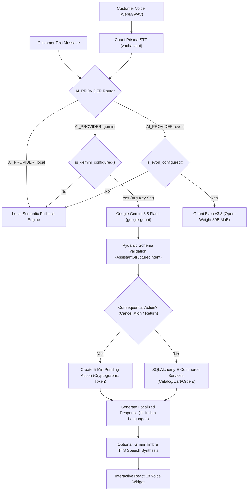

# VoiceIQ India — Google Gemini 3.8 Flash Integration Guide

## 1. Executive Summary

VoiceIQ India integrates **Google Gemini 3.8 Flash (`gemini-3.8-flash`)** as its primary conversational AI and multilingual Indic reasoning LLM for e-commerce shopping assistance, catalog search, order management, and customer support.

The integration is built upon the official modern **`google-genai` SDK** (v2+), avoiding deprecated packages. When an API key is not configured, the system provides zero-downtime, deterministic fallback to the local semantic engine.

---

## 2. Architecture & Pipeline



---

## 3. Configuration & Environment Variables

Configure the following variables in `backend/.env` or root `.env`:

```env
# Primary AI Provider Routing ('gemini', 'evon', or 'local')
AI_PROVIDER=gemini

# Google Gemini 3.8 Flash Configuration
GEMINI_ENABLED=true
GEMINI_API_KEY="your-google-ai-studio-api-key"
GEMINI_MODEL="gemini-3.8-flash"
GEMINI_TIMEOUT_SECONDS=60.0
GEMINI_MAX_OUTPUT_TOKENS=512
GEMINI_TEMPERATURE=0.6

# Gnani Evon v3.3 (Retained as alternate / standby provider)
EVON_ENABLED=false
EVON_HF_REPO_ID="gnani/gnani-evon-v3.3-30B-A3B"
EVON_BASE_URL=""
EVON_MODEL_NAME="evon"
```

---

## 4. Supported Indian Languages (11 Languages)

Google Gemini 3.8 Flash extracts structured intent across all major Indian languages supported by VoiceIQ India:
- **English (`en-IN`)**
- **Hindi (`hi-IN`)**
- **Kannada (`kn-IN`)**
- **Tamil (`ta-IN`)**
- **Telugu (`te-IN`)**
- **Malayalam (`ml-IN`)**
- **Marathi (`mr-IN`)**
- **Bengali (`bn-IN`)**
- **Gujarati (`gu-IN`)**
- **Punjabi (`pa-IN`)**
- **Odia (`or-IN`)**

---

## 5. Consequential Action Safety

Cancellations and returns require explicit human confirmation. Gemini 3.8 Flash flags these operations with `requires_confirmation: true`. The orchestrator:
1. Validates authenticated customer ownership and order eligibility.
2. Creates an immutable `PendingAction` in the database with a 5-minute time-to-live.
3. Generates a cryptographically secure, unguessable single-use confirmation token.
4. Requires the token at `POST /api/assistant/confirm-action` to atomically execute the status transition within an ACID transaction.

---

## 6. Diagnostic Endpoints

### 1. General Assistant Health
`GET /api/assistant/health`
```json
{
  "status": "healthy",
  "service": "VoiceIQ India Voice Assistant",
  "ai_provider": "gemini",
  "gemini_llm": {
    "enabled": true,
    "configured": false,
    "model_name": "gemini-3.8-flash",
    "health": {
      "available": false,
      "configured": false,
      "model": "gemini-3.8-flash",
      "provider": "google-gemini",
      "error": "Gemini API key is not configured (set GEMINI_API_KEY)"
    }
  },
  "evon_llm": {
    "enabled": false,
    "configured": false,
    "model_name": "evon",
    "hf_repo_id": "gnani/gnani-evon-v3.3-30B-A3B"
  },
  "gnani_speech": {
    "configured": true,
    "base_url": "https://api.vachana.ai",
    "stt_endpoint": "/stt/v3",
    "tts_endpoint": "/api/v1/tts/inference"
  }
}
```

### 2. Gemini Status & Capabilities
`GET /api/assistant/gemini/status`
```json
{
  "provider": "gemini",
  "model_id": "gemini-3.8-flash",
  "configured": false,
  "enabled": true,
  "timeout_seconds": 60.0,
  "supported_languages": [
    "English", "Hindi", "Bengali", "Telugu", "Tamil",
    "Marathi", "Gujarati", "Kannada", "Malayalam", "Odia", "Punjabi"
  ],
  "health": {
    "available": false,
    "configured": false,
    "model": "gemini-3.8-flash",
    "provider": "google-gemini"
  }
}
```

---

## 7. Verification & Testing

- **Backend Unit & Integration Tests**:
  ```powershell
  cd backend
  .\.venv\Scripts\python.exe -m pytest tests/test_gemini_client.py tests/test_gemini_integration.py -v
  ```
- **Optional Real Live Inference Test** (runs only when `GEMINI_API_KEY` is configured):
  ```powershell
  cd backend
  .\.venv\Scripts\python.exe -m pytest tests/test_gemini_real_inference.py -v -s
  ```
- **Frontend Production Build**:
  ```powershell
  cd client
  npm run build
  ```

